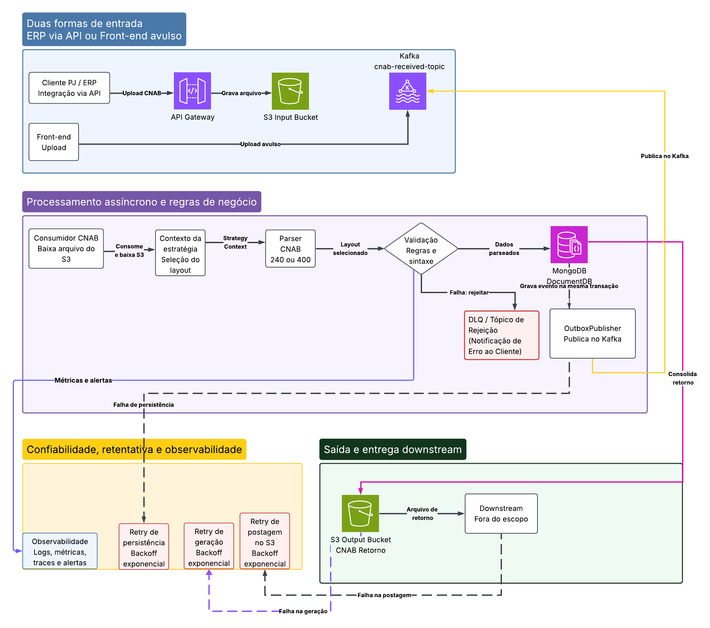

# CNAB Async Hub

> ⚠️ **Projeto em Desenvolvimento / Em Construção:** Algumas funcionalidades e refatorações ainda estão sendo implementadas para atingir o escopo final.
> 
[](https://openjdk.org/projects/jdk/21/)
[](https://spring.io/projects/spring-boot)
[](https://kafka.apache.org/)
[](https://www.mongodb.com/)
[](https://min.io/)

Hub assíncrono de remessa/retorno CNAB (240 e 400), no mesmo recorte de um processamento bancário real: o cliente PJ manda o arquivo, o banco não processa na request HTTP, e o retorno regulatório sai depois — com retry, DLQ e rastreio.

Java 21, Spring Boot 3, Kafka, MongoDB e MinIO (S3). Feito para conversar vaga sênior sem ser um hello-world de producer/consumer.

<details>
  <summary><b>Ver diagrama completo de arquitetura</b></summary>
  <br>
  
</details>

## O problema

Empresa PJ (ERP ou upload avulso) envia um arquivo CNAB de pagamentos. O arquivo é grande, as regras dependem do layout Febraban, e a entrega para o banco central / downstream não pode travar o HTTP. O fluxo correto é:

1. Receber e gravar o arquivo (S3).
2. Publicar um evento (`cnab-received`).
3. Consumir, baixar, escolher o parser (Strategy 240 vs 400), validar, persistir.
4. Gerar o CNAB de retorno e postar no bucket de saída.
5. Se a regra de negócio falhar, rejeitar em tópico próprio. Se a infra falhar depois do retry, ir para DLT técnica.
## Arquitetura
```
ERP API / Front avulso
        │  multipart
        ▼
   API Gateway (Spring)
        │  grava S3 input + outbox Mongo
        ▼
   Kafka  cnab-received
        │
        ▼
 Consumidor CNAB
   download S3 → Strategy layout → Parser → Validação
        │                         │
        │ ok                      │ regra inválida
        ▼                         ▼
   Mongo persistência      cnab-rejection-dlq
   retry + backoff             (erro para o cliente)
        │
        ▼
   Gera retorno  →  retry postagem S3 output
        │
        ▼
   Arquivo .ret  + status DELIVERED
```
## Padrões de Arquitetura e Engenharia:

| Padrão | Onde está |
| --- | --- |
| Strategy | `CnabParseStrategy` 240/400 |
| Outbox | Mongo `outbox` + `OutboxPublisher` (HTTP não fala com Kafka direto) |
| Idempotência | hash SHA-256 do arquivo + status `DELIVERED` no consumer |
| DLQ de negócio vs DLT técnica | validação → `cnab-rejection-dlq`; exception após retry Kafka → `cnab-received.DLT` |
| Retry exponencial | Resilience4j (`persistencia`, `geracao`, `postagemS3`) + `DefaultErrorHandler` no Kafka |
| Observabilidade | `correlationId` no MDC/header, Actuator, Prometheus |
## Como rodar
Precisa de Docker (Kafka, Mongo, MinIO) e um JDK. O Gradle sobe com o JDK 17 que já existe em `~\.jdks\ms-17.0.20.1` e baixa o JDK 21 via toolchain.
```powershell
$env:JAVA_HOME = "$env:USERPROFILE\.jdks\ms-17.0.20.1"
cd $env:USERPROFILE\cnab-async-hub
docker compose up -d
.\gradlew.bat test
.\gradlew.bat bootRun
```
- Front avulso: http://localhost:8080
- Swagger: http://localhost:8080/swagger-ui.html
- Saúde: http://localhost:8080/actuator/health
- MinIO console: http://localhost:9001 (`minioadmin` / `minioadmin`)
  Demo sem arquivo:
```powershell
curl -X POST http://localhost:8080/api/v1/remessas/demo?layout=CNAB_240
```
Acompanhe até `DELIVERED`:
```powershell
curl http://localhost:8080/api/v1/remessas
```
Forçar retry :
```powershell
curl -X POST http://localhost:8080/api/v1/remessas/demo?layout=CNAB_240 -H "X-Demo-Fail: persist"
```
Valores: `persist`, `geracao`, `s3`. Depois de 3 tentativas o consumer estoura e o Kafka manda para `cnab-received.DLT`.
## API
| Método | Caminho | Efeito |
| --- | --- | --- |
| POST | `/api/v1/remessas` | upload multipart (`source=API` ou `FRONTEND`) |
| POST | `/api/v1/remessas/demo` | gera remessa válida e dispara o fluxo |
| GET | `/api/v1/remessas` | últimos processamentos |
| GET | `/api/v1/remessas/{id}` | status |
| GET | `/api/v1/remessas/{id}/retorno` | download do `.ret` |
Tópicos Kafka: `cnab-received`, `cnab-rejection-dlq`, `cnab-received.DLT`.
## Decisões de arquitetura

- **Por que Kafka e não só `@Async`?**  
  O arquivo precisa sobreviver a restart, ser reprocessado, e o mesmo evento pode alimentar parser, notificação e auditoria. Consumer group + partição por `correlationId`/cliente mantém ordem por empresa.

- **Por que Outbox?**  
  Se o HTTP gravar no S3 e o `KafkaTemplate.send` falhar, você fica com arquivo órfão. O Outbox persiste o evento no Mongo e um scheduler publica. Em produção isso entra em transação de replica set.

- **Dois tipos de falha**  
  Sintaxe/regra (CNPJ vazio, valor zero, trailer inconsistente) é rejeição de negócio — o cliente precisa saber. Timeout de S3/Mongo é falha técnica — retry com backoff e DLT.

## Escopo

Este repositório foca no **miolo assíncrono** (ingestão → parse → validação → retorno → confiabilidade).  
Não implementa layout Febraban completo, autenticação de ERP, PIX/TED por convênio nem integração com CIP/Banco Central.

## Testes
```powershell
.\gradlew.bat test
```
Cobrem parser 240/400, escolha de Strategy, validação, ingest (outbox + idempotência), consumer e o processor até `DELIVERED` ou DLQ de negócio.